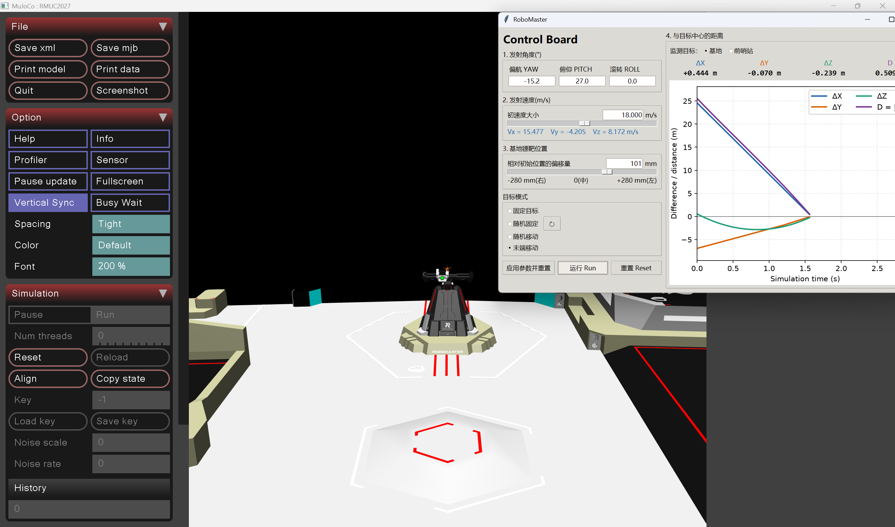

# 更新

与v1.7相比:

1.增加了四种运动方式的控制:
    
    固定目标:位于中间静止不动;
    随即固定:仿真开始时,瞬移至某一位置静止不动;
    随机移动:仿真开始时,瞬移至某一位置开始随机运动,0.6s后静止不动;
    末端移动:仿真开始时,瞬移至某一位置静止不动,1.2s后开始随机运动,又0.6s后静止不动;

运行main.py即可进行仿真;

### 运行效果

