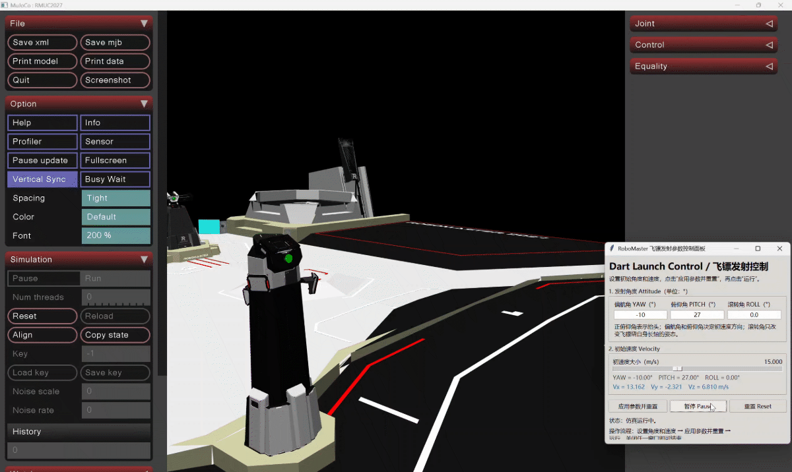
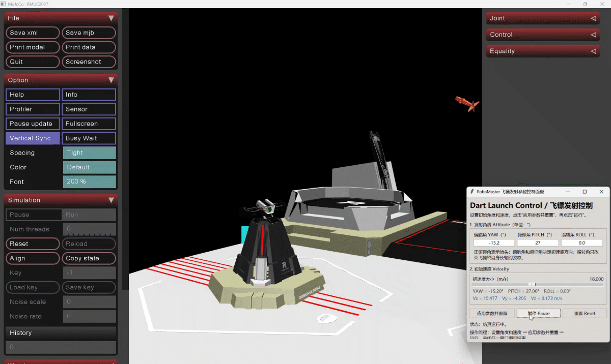

# 更新

与v1.1相比:

1.上一版沿用了默认接触参数,高速碰撞时接触约束响应不够迅速,飞镖会穿透镖靶碰撞体。经调整后,将仿真步长设为0.2ms,接触约束时间常数(solref)设为1ms。在当前测试条件下,飞镖沿镖靶表面法线方向的速度分量小于25m/s时,不会发生穿透(《RoboMaster 2027 机器人制作规范手册》2.4.5节、表2-12（第36页）规定：飞镖射击初速度不限，但超过25m/s时，裁判系统可能无法检测到飞镖。)。

2.击中基地[YAW=-15.2°  PITCH=27°  ROLL=0°  初速度=18.000m/s];

3.击中前哨站[YAW=-10°  PITCH=27°  ROLL=0°  初速度=15.000m/s];

4.这是第一版能运行全流程的(发射参数调整+弹道显示+镖靶碰撞仿真);

运行main.py即可进行仿真;

### 前哨站碰撞仿真

### 基地碰撞仿真

